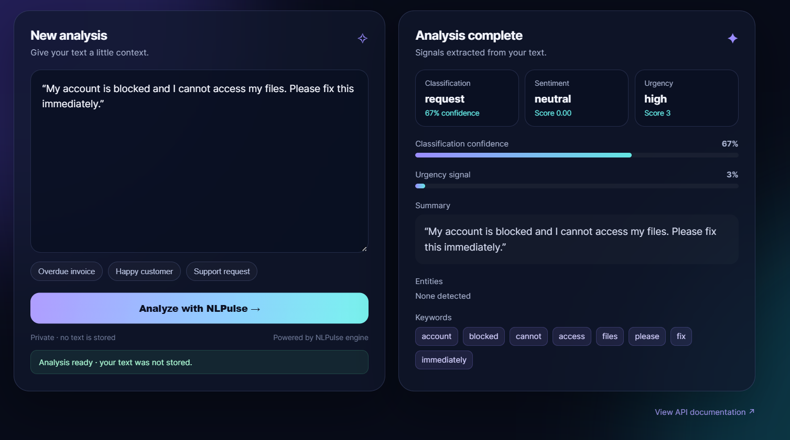

# NLPulse AI

**NLPulse AI: Intelligent Document and Email Understanding, Classification & Information Extraction Platform**

NLPulse AI turns unstructured emails and documents into searchable, structured intelligence. It provides a CPU-friendly local dashboard and FastAPI service for ingestion, analysis, persistence, machine-learning classification, and similarity search.

## Live application preview



The screenshot shows the live analysis workflow with classification, sentiment, urgency, summary, entities, and extracted keywords.

## Setup

Use Python 3.10+ and create a virtual environment:

```bash
python -m venv .venv
# Windows PowerShell
.\.venv\Scripts\Activate.ps1
pip install -r requirements.txt
# For the dashboard and test tools
pip install -r requirements-dev.txt
```

## Run

Start the frontend from the project root:

```bash
streamlit run dashboard/app.py
```

Run the test suite:

```bash
pytest
```

Start the API separately with:

```bash
uvicorn api.main:app --reload
```

Then open `http://127.0.0.1:8000/docs` for the interactive API documentation.

## API endpoints

| Endpoint | Purpose |
| --- | --- |
| `GET /health` | Service status and document count |
| `POST /analyze` | Analyze pasted text and optionally save it |
| `POST /documents/upload` | Extract, analyze, and save TXT, CSV, PDF, or DOCX |
| `GET /documents` | List stored documents |
| `GET /documents/{id}` | Read a document, its analyses, and entities |
| `DELETE /documents/{id}` | Delete a document and its related results |
| `POST /search` | TF-IDF cosine similarity search |
| `GET /analytics/overview` | Category, sentiment, urgency, and recent-document analytics |
| `GET /documents/export.csv` | Export filtered document metadata as CSV |
| `POST /models/train` | Train the CPU-friendly learned classifier |

Example:

```powershell
curl.exe -X POST http://127.0.0.1:8000/analyze `
  -H "Content-Type: application/json" `
  -d '{"name":"support-email.txt","text":"Urgent: my account is blocked and I need help."}'
```

## Current MVP scope

The application includes local SQLite persistence in `data/nlpulse.db`, file extraction, rule-based analysis, and an optional scikit-learn TF-IDF classifier. No external API key or cloud service is required.

## Future ML extensions

Potential next steps include transformer-based sentiment and summarization, custom NER training, multilingual support, model confidence calibration, larger labeled datasets, authentication, and production deployment.

## Project layout

```text
api/             FastAPI application
dashboard/       Streamlit interface
src/             NLP, ingestion, database, ML, and search modules
evaluation/      Model evaluation utilities
tests/           Unit and API behavior tests
data/            Local SQLite database and user-generated files
```

## Current model limitations

The default analysis pipeline is intentionally transparent and deterministic. Its rules are a baseline, not a claim of production-level accuracy. The learned classifier uses a small built-in dataset so that the complete training flow can be demonstrated; replace it with a properly labeled project dataset before reporting model performance.

## Train and evaluate a learned classifier

Use the included labeled sample as a workflow example:

```powershell
python scripts/train_model.py data/sample_training.csv
python -m evaluation.evaluate data/sample_training.csv --algorithm both
```

The evaluation output reports accuracy, macro precision, macro recall, macro F1, class labels, and a confusion matrix. The included dataset is deliberately small for demonstration; do not present its score as production performance. Replace it with a larger, organization-specific labeled dataset before making model claims.

## Deployment

Vercel deployment files are included for the FastAPI API:

```text
vercel.json
api/index.py
```

See [DEPLOYMENT.md](DEPLOYMENT.md) for Vercel API and Streamlit dashboard deployment instructions. Vercel's filesystem is ephemeral, so use external database storage for production persistence.

The Vercel deployment also includes a browser UI at the site root. The Streamlit dashboard remains available for local or Streamlit Cloud deployment.
